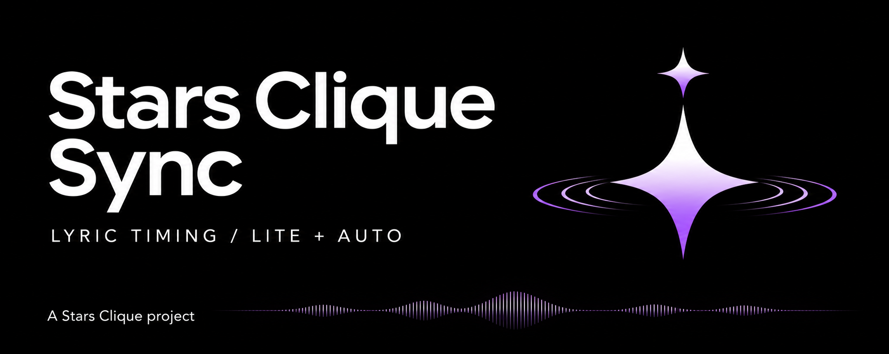
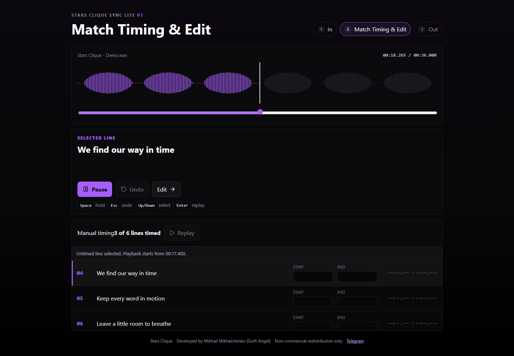
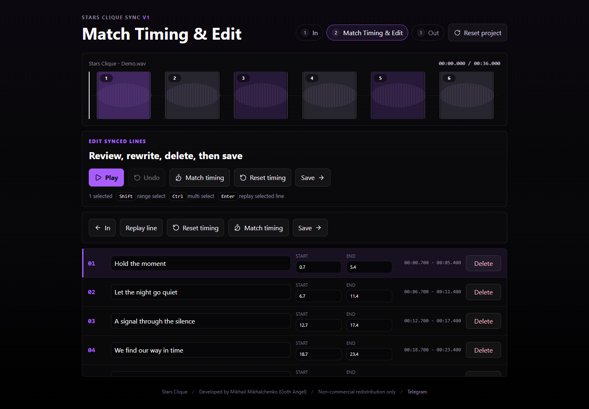

<p align="center">
  
</p>

<h1 align="center">Stars Clique Sync</h1>
<p align="center">Line-by-line lyric timing for music. Export TTML, LRC, or project JSON.</p>
<p align="center">
  A Stars Clique project · Developed by <strong>Mikhail Mikhalchenko (Goth Angel)</strong>
</p>
<p align="center">
  <a href="docs/stars-clique-sync-guide-en.pdf">English manual (PDF)</a> ·
  <a href="docs/stars-clique-sync-guide-ru.pdf">Руководство на русском (PDF)</a> ·
  <a href="https://t.me/starsclique">Stars Clique on Telegram</a>
</p>

## Editions

### Open Lite in Your Browser

[Launch Stars Clique Sync Lite](https://9519860664r-oss.github.io/stars-clique-sync/)

Use manual timing, import LRC or TTML, edit lines, and export directly in your
browser. Audio and lyrics stay on your device. Keep the tab open until you have
exported your work.

On **In**, drop audio onto the page or use the file picker. Lite also accepts
one LRC or TTML file, either separately or in the same drop as the audio.

To edit an LRC or TTML file without audio, import it on **In** and select
**Continue**. Edit the lyrics and timestamps, select **Save**, and download
the original format. LRC stores only line starts. TTML timing checks still
run, except for the audio duration limit.

### Windows Installers

- [Download Lite 1.0.6](https://github.com/9519860664r-oss/stars-clique-sync/releases/download/v1.0.6/Stars-Clique-Sync-Lite-Setup-1.0.6.exe)
- [Download Auto 1.0.6](https://github.com/9519860664r-oss/stars-clique-sync/releases/download/v1.0.6/Stars-Clique-Sync-Auto-Setup-1.0.6.exe)

Both installers include English and Russian PDF manuals. Auto downloads its
Whisper model on first use. See the [release notes](https://github.com/9519860664r-oss/stars-clique-sync/releases/tag/v1.0.6)
for system requirements and checksums.

| Edition | Workflow |
| --- | --- |
| **Lite** | Time your own lyrics by holding Space. Import existing LRC or TTML and edit the text and timings. Runs without Whisper or a separate server. |
| **Auto** | Use the manual workflow or create a draft with local Whisper recognition. You can paste existing lyrics or recognize them from the track. |

Both editions let you review the waveform, adjust timestamps, replay lines,
and export your work. The Auto edition can align supplied lyrics against the
track while keeping the supplied words.

## Workspace

### Manual Timing

Hold Space for each phrase. The current line stays in view while the waveform
and playback controls remain visible.



### Review and Edit

Replay a phrase, adjust its start and end, then save the result for export.



Screenshots show the real application with synthetic demo audio and original
sample lyrics.

## Quick Start

Run the Lite web app from a checkout with Node.js 24 and npm installed.

```sh
cd lite
npm ci
npm run dev -- --host 127.0.0.1 --port 5174 --strictPort
```

Open [127.0.0.1:5174](http://127.0.0.1:5174/). Choose an audio file, paste one
lyric phrase per line, and select **Continue**. Press Space at the start of each
phrase and release it at the end. Review the result in **Edit**, then select
**Save** and choose an export format.

## LRC Export

LRC exports in both editions use millisecond timestamps, for example
`[00:14.592]Lyric line`. Minutes are not split into an hours field.

## TTML Export

In **Out**, fill in **Title**, **Subtitle**, and **Artist**, or leave them blank.
The title is prefilled from the audio filename; edit or clear it as needed.
Subtitle is a version label: `Song` plus `Acoustic` exports as `Song (Acoustic)`.
Only supplied details are included. With no metadata, the download uses the audio
filename. Select **TTML** when ready.

There is one TTML exporter, based on Zvonko's reference structure. There are no
profile or language selectors. The reference XML language tag is retained;
Russian and English lyric text are both preserved unchanged.

The exporter checks every line before downloading. **Exceeding Time** flags a
start or end beyond the loaded audio's duration. **Time Crossing** flags an
interval that starts before an earlier line ends. Missing, reversed, negative,
or sub-millisecond timings also block TTML export. Select **Line N** to return
to the offending row in Edit. LRC and project JSON remain available for backup.

Checks do not shift, reorder, or drop lyrics automatically. Use the exact audio
master that you will deliver. Passing these local checks does not guarantee
Zvonko moderation approval; their complete validator rules are not public.

See the [developer guide](docs/development.md) for the Auto backend, Windows
installers, and integration details.

## Recognition Quality

**Automatic recognition produces an editable draft.** Singing, heavy effects,
backing vocals, dense mixes, and fast delivery can cause wrong, missing, or
invented words in English and Russian. Timing can drift even when the words
are correct. Review the transcript and timestamps by ear before exporting.

The Auto edition uses Whisper `medium` by default. On an internal set of
20 full tracks, it scored 42.6% word error rate (WER), compared with 44.2% for
`large-v3`. On the nine tracks with human-annotated reference lyrics, scores
were 27.3% and 24.2%, respectively. Lower WER is better. This small test is
illustrative. Some artist-provided references abbreviate repeated sections.

## Attribution and License

Stars Clique Sync is **source-available**. You may adapt it and share it
non-commercially under the [project license](LICENSE.md). Keep the Stars Clique
branding and the original developer credit. Label any public modified build
as unofficial and identify your changes.
